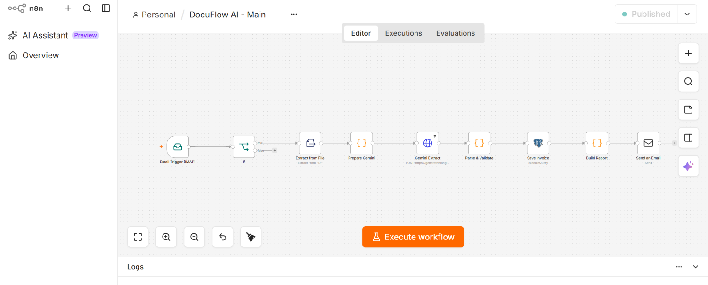

# DocuFlow AI

Automatisation du traitement de factures PDF avec n8n, PostgreSQL et un LLM.

Un e-mail contenant une facture PDF déclenche le workflow : lecture du texte,
extraction structurée par LLM, validation métier, enregistrement en base,
puis rapport envoyé par e-mail.



## Fonctionnalités
- Déclenchement par e-mail (Gmail, libellé dédié alimenté par un filtre)
- Filtrage des pièces jointes PDF
- Extraction du texte du PDF (nœud n8n Extract From File)
- Extraction JSON structurée avec Gemini (fournisseur, n° facture, date, devise, montants, lignes)
- Validation : champs obligatoires, format de date, devise, cohérence des montants et des lignes
- Détection des doublons (fournisseur + numéro de facture), protégée aussi par un index unique en base
- Enregistrement PostgreSQL ; les factures anormales sont marquées `needs_review`
- Rapport HTML par e-mail : succès, doublon ou à vérifier
- Workflow d'erreur dédié : journalisation dans `processing_logs` et alerte e-mail
- Réessais automatiques en cas d'indisponibilité de l'API

## Architecture
```
E-mail → If (PDF) → Extract From File → Gemini → Parse & Validate
       → PostgreSQL (anti-doublon) → Rapport e-mail
Erreur → Error Handler → processing_logs + alerte e-mail
```

## Stack
n8n · PostgreSQL 16 · Docker · Gemini API · IMAP/SMTP Gmail · JavaScript

## Installation
1. `cp .env.example .env` puis choisir un mot de passe
2. `docker compose up -d`
3. Importer les deux fichiers de `workflows/` dans n8n
4. Créer les credentials : IMAP, SMTP, Postgres, Header Auth (clé Gemini)
5. Associer l'Error Handler dans Settings → Error Workflow du workflow principal
6. Dans Gmail, créer un libellé `DocuFlow` et un filtre :
   `subject:facture has:attachment filename:pdf`

## Tests réalisés
| Cas | Résultat |
|---|---|
| Facture valide | Enregistrée (`validated`), rapport de succès |
| Même facture renvoyée | Rapport « Doublon ignoré », aucune insertion |
| Total incohérent (`samples/`) | Enregistrée en `needs_review`, rapport « À vérifier » |
| Panne de l'API LLM | Alerte e-mail et ligne dans `processing_logs` |

## Limites connues
- Les PDF scannés (sans couche texte) ne sont pas pris en charge : une étape OCR est prévue
- Le trigger IMAP se déconnecte parfois et peut retarder le traitement de quelques minutes
- L'offre gratuite de Gemini peut renvoyer des erreurs 503 (gérées par des réessais)
- Les données de test sont fictives ; ne pas envoyer de factures réelles à l'API gratuite

## Auteur
Moussa Diakite